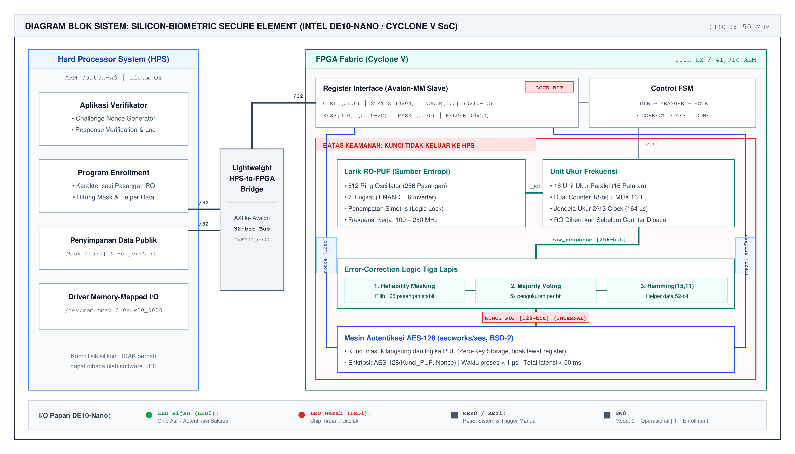

# Silicon-Biometric Secure Element

**Rancang Bangun Silicon-Biometric Secure Element Berbasis Ring Oscillator PUF dan Error-Correction Logic pada SoC FPGA untuk Autentikasi Anti-Kloning Identitas Digital**

> PERURI Chip Hackathon 2026 — Topik 01: Secure Identity & Security Element Chip

[]()
[]()
[]()

---

## Deskripsi

Proyek ini mengimplementasikan **secure element** berbasis perangkat keras yang menggunakan **Physically Unclonable Function (PUF)** jenis Ring Oscillator untuk menghasilkan kunci kriptografi unik dari karakteristik fisik silikon. Kunci tidak pernah disimpan di memori — dibangkitkan ulang setiap kali dibutuhkan dan langsung digunakan oleh mesin **AES-128** di dalam FPGA fabric.

### Fitur Utama

- **Ring Oscillator PUF**: 512 RO (256 pasangan) dengan penempatan simetris
- **Error Correction 3 Lapis**: Reliability masking → Majority voting → Hamming(15,11)
- **AES-128 Authentication**: Kunci PUF langsung mengalir ke AES — tidak pernah melewati prosesor
- **Avalon-MM Interface**: Register memory-mapped pada Lightweight Bridge
- **Security-by-Design**: Bit LOCK mencegah pembacaan data mentah setelah enrollment

## Arsitektur Sistem



Sistem terdiri atas empat domain fungsional:
1. **Larik RO-PUF (Fabric FPGA)**: 512 Ring Oscillator (256 pasangan komparasi *disjoint*) ditempatkan secara simetris dalam Logic Lock Region.
2. **Pencacahan Paralel (16× Measure Units)**: Mengukur selisih frekuensi per pasangan dengan jendela sampling $2^{13}$ siklus clock (bebas metastabilitas via asynchronous counter gating).
3. **Stabilisasi Kunci (Error-Correction 3 Lapis)**: Reliability masking (eliminasi 61 pasangan paling labil) → Temporal majority voting (5 ronde) → Hamming(15,11) syndrome correction dengan 52-bit helper data.
4. **Mesin Autentikasi AES-128**: Menjalankan enkripsi challenge-response *zero-key exposure* di dalam fabric (kunci tidak pernah dapat dibaca prosesor).

## Struktur Direktori

```
silicon-biometric-puf/
├── rtl/                    # RTL Verilog source files
│   ├── ro_cell.v           # Ring Oscillator cell (7-stage inverter loop)
│   ├── ro_array.v          # Larik 512 RO (256 pasangan terpartisi 16 bank)
│   ├── measure_unit.v      # Unit pencacah frekuensi asinkron (×16 paralel)
│   ├── error_correction.v  # Stabilisasi kunci: Masking, Voting, Hamming(15,11)
│   ├── aes_auth.v          # Wrapper mesin autentikasi AES-128
│   ├── control_fsm.v       # FSM master sequencer
│   ├── puf_regs.v          # Register Avalon-MM (Lightweight Bridge)
│   ├── puf_top.v           # Top-level modul FPGA DE10-Nano
│   └── aes/                # Petunjuk integrasi core secworks/aes (BSD-2)
├── tb/                     # Rangkaian testbench simulasi
│   ├── tb_ro_cell.v        # SIM-1: Karakterisasi RO & unit ukur
│   ├── tb_fsm_measure.v    # SIM-2: Sekuens FSM 16 bank × 5 putaran
│   ├── tb_majority_vote.v  # SIM-3: Majority voting dengan injeksi derau
│   ├── tb_hamming.v        # SIM-4: Dekoder Hamming(15,11) & deteksi fail
│   ├── tb_aes_auth.v       # SIM-5: Verifikasi AES-128 test vector FIPS-197
│   └── tb_puf_top.v        # SIM-6: Transaksi bus Avalon-MM & proteksi LOCK
├── constraints/            # Berkas constraint perangkat keras
│   ├── puf_timing.sdc      # Timing constraint 50 MHz & false-path RO
│   └── puf_pins.qsf        # Pin assignments Cyclone V SE (DE10-Nano)
├── quartus/                # Proyek Intel Quartus Prime Lite
│   ├── silicon_biometric_puf.qpf
│   └── silicon_biometric_puf.qsf
├── sw/hps/                 # Perangkat lunak HPS (ARM Cortex-A9 Linux)
│   ├── puf_driver.h        # Definisi peta register & makro MMIO
│   ├── puf_enroll.c        # Utilitas enrollment satu kali
│   ├── puf_verify.c        # Daemon verifikasi autentikasi challenge-response
│   └── Makefile            # Skrip kompilasi silang ARM GCC
├── scripts/                # Analisis statistik & dataset contoh
│   ├── puf_analysis.py     # Skrip evaluasi Uniformity, Uniqueness, Reliability
│   ├── hamming_distance.py # Modul kalkulasi metrik jarak Hamming
│   ├── sample_inter_chip.csv # Dataset contoh respons inter-chip (20 chip)
│   └── sample_intra_chip.csv # Dataset contoh respons intra-chip (100 sampling)
└── docs/                   # Berkas dokumentasi & proposal
    ├── Proposal-Hackathon-CHIP-2026-Ruang-Circuit.pdf # Dokumen proposal final
    └── images/             # Diagram arsitektur (PNG HD 300 DPI, SVG, Draw.io, PPTX)
```

## Target Platform

| Komponen | Spesifikasi |
|----------|-------------|
| Board | Terasic DE10-Nano |
| FPGA | Cyclone V SE 5CSEBA6U23I7 |
| HPS | ARM Cortex-A9 (dual core) |
| Clock | 50 MHz |
| Bridge | Lightweight HPS-to-FPGA |

## Estimasi Resource

| Resource | Estimasi | Kapasitas |
|----------|----------|-----------|
| ALM | ~6.000–9.000 | 41.910 |
| Registers | ~3.000–5.000 | 415.000 |
| M10K RAM | < 20 Kbit | 5.570 Kbit |
| DSP Blocks | 0 | 112 |
| Latensi | < 50 ms | — |

## Alur Operasi

### Enrollment (satu kali, di fasilitas terpercaya)
1. Setiap pasangan RO diukur berulang kali
2. Pasangan paling stabil dipilih sebagai **mask** (256-bit)
3. **Helper data** (52-bit) dihitung dari Hamming encoding
4. Kunci didaftarkan ke basis data verifikator
5. Bit **LOCK** diaktifkan — data mentah tidak bisa dibaca lagi

### Autentikasi (di lapangan)
1. Verifikator mengirim **nonce** acak 128-bit
2. FPGA merekonstruksi kunci dari PUF + mask + helper data
3. FPGA menghitung **AES-128(Key, Nonce)**
4. Verifikator mencocokkan — chip tiruan tidak bisa menghasilkan jawaban yang benar

## Register Map (Avalon-MM)

| Offset | Register | Akses | Fungsi |
|--------|----------|-------|--------|
| 0x00 | CTRL | W | bit0: START_PUF, bit1: START_AUTH, bit31: LOCK |
| 0x04 | STATUS | R | BUSY, DONE, KEY_VALID, ECC_FAIL, LOCKED |
| 0x08 | PAIR_SEL | W | Indeks pasangan untuk pembacaan mentah |
| 0x0C | RAW_DIFF | R | Selisih counter (0 saat LOCKED) |
| 0x10–0x1C | NONCE[0..3] | W | Challenge 128-bit |
| 0x20–0x2C | RESP[0..3] | R | Response AES-128 |
| 0x30–0x4C | MASK[0..7] | R/W | Mask 256-bit |
| 0x50–0x54 | HELPER[0..1] | R/W | Helper data 52-bit |

## Simulasi & Pengujian

| Kode | Skenario | Cara Menjalankan |
|------|----------|------------------|
| SIM-1 | Model RO + unit ukur | `iverilog -o sim1 tb/tb_ro_cell.v rtl/ro_cell.v rtl/measure_unit.v && vvp sim1` |
| SIM-2 | Urutan FSM 16×5 | `iverilog -o sim2 tb/tb_fsm_measure.v rtl/control_fsm.v && vvp sim2` |
| SIM-3 | Majority voting + noise | `iverilog -o sim3 tb/tb_majority_vote.v rtl/error_correction.v && vvp sim3` |
| SIM-4 | Hamming decoder exhaustive | `iverilog -o sim4 tb/tb_hamming.v rtl/error_correction.v && vvp sim4` |
| SIM-5 | AES-128 FIPS-197 | `iverilog -o sim5 tb/tb_aes_auth.v rtl/aes_auth.v rtl/aes/*.v && vvp sim5` |
| SIM-6 | Register + LOCK | `iverilog -o sim6 tb/tb_puf_top.v rtl/*.v rtl/aes/*.v && vvp sim6` |

## Metrik Keberhasilan

| Metrik | Target |
|--------|--------|
| Uniformity | 45–55% |
| Uniqueness (inter-chip HD) | 40–50% |
| Reliability (intra-chip HD) | Bit error < 5% |
| Rekonstruksi kunci | 0 gagal dalam ≥ 1.000 percobaan |
| Uji kloning | 100% ditolak |
| Latensi (START → DONE) | < 50 ms |
| Utilisasi ALM | < 25% |

## Dependensi

- **Quartus Prime Lite** (20.1 atau lebih baru) — Sintesis dan implementasi
- **ModelSim / Questa Intel FPGA Edition** — Simulasi RTL
- **secworks/aes** — AES-128 core ([GitHub](https://github.com/secworks/aes), BSD-2 License)
- **GCC ARM Cross-Compiler** (`arm-linux-gnueabihf-gcc`) — Kompilasi software HPS
- **Python 3** + NumPy + Matplotlib — Analisis statistik PUF

## Cara Menggunakan

### 1. Clone Repository
```bash
git clone https://github.com/riezky-gitH/silicon-biometric-puf.git
cd silicon-biometric-puf
git submodule update --init --recursive
```

### 2. Simulasi
```bash
# Jalankan semua testbench
cd tb
iverilog -o sim1 tb_ro_cell.v ../rtl/ro_cell.v ../rtl/measure_unit.v && vvp sim1
```

### 3. Sintesis (Quartus)
1. Buka `quartus/silicon_biometric_puf.qpf` di Quartus Prime Lite
2. Compile Design (Processing → Start Compilation)
3. Program DE10-Nano via USB-Blaster

### 4. Build Software HPS
```bash
cd sw/hps
make
scp puf_enroll puf_verify root@<de10-nano-ip>:~/
```

### 5. Jalankan di Board
```bash
# Di DE10-Nano (via SSH)
./puf_enroll          # Enrollment (satu kali)
./puf_verify          # Autentikasi
```

### 6. Analisis Statistik PUF (Python)
Evaluasi metrik kualitas fisik PUF menggunakan dataset contoh atau data hasil pengukuran hardware:
```bash
cd scripts
python puf_analysis.py --inter sample_inter_chip.csv --intra sample_intra_chip.csv
```
Metrik yang dievaluasi mencakup:
- **Uniformity**: Keseimbangan proporsi bit 0 dan 1 (target: 45–55%).
- **Uniqueness**: Jarak Hamming inter-chip antar-perangkat (target: 45–55%, ideal 50%).
- **Reliability**: Jarak Hamming intra-chip dan Bit Error Rate (target: BER < 5%, reliability > 95%).

## Referensi

1. G. E. Suh dan S. Devadas, "Physical Unclonable Functions for Device Authentication and Secret Key Generation," *DAC*, 2007
2. A. Maiti et al., "A Large Scale Characterization of RO-PUF," *HOST*, 2010
3. A. Maiti dan P. Schaumont, "Improved Ring Oscillator PUF," *Journal of Cryptology*, 2011
4. Y. Dodis et al., "Fuzzy Extractors," *SIAM Journal on Computing*, 2008
5. NIST, *FIPS 197: Advanced Encryption Standard (AES)*, 2001
6. J. Strömbergson, "secworks/aes," GitHub (BSD-2)
7. Intel Corp., *Cyclone V HPS Technical Reference Manual*
8. Terasic Inc., *DE10-Nano User Manual*

## Tim

**Ruang Circuit** — Politeknik Elektronika Negeri Surabaya (PENS)

| Nama | Peran |
|------|-------|
| Mochammad Riezky Syahrani Yusuf | Arsitek sistem, RTL PUF, integrasi top-level |
| Imam Arifin | Integrasi SoC, software HPS, Platform Designer |
| M. Hilmi Haidar Yahya | Verifikasi dan pengujian, testbench, SignalTap |
| Muhammad Haniifan | Error correction, analisis data, integrasi AES |

**Dosen Pembimbing**: Taufiqurrahman, S.ST., M.T.

## Lisensi

Proyek ini dilisensikan di bawah [MIT License](LICENSE).  
AES-128 core menggunakan [secworks/aes](https://github.com/secworks/aes) dengan lisensi BSD-2.
